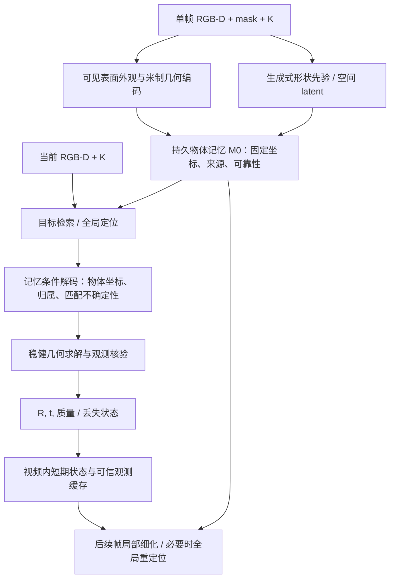

# 目标：单帧建立物体记忆，跨视频估计未见物体的 6D 位姿

本文件记录 2026-10-20 确认的系统目标、研究假设和实现边界。
当前 V1 是可训练框架；完成接口和测试不代表已达到下述精度或泛化目标。

## 任务合同

一个训练时未见的刚性物体，只提供**一帧 RGB、注册深度、目标 mask、相机内参
和深度单位**，网络为它建立可持久保存的物体 latent。新物体只编码一次，
测试时不针对该物体更新网络权重。同一记忆可以用于不同视频、背景和相机下的同一物体。

本阶段将后续视频定义为 **RGB-D 视频**，每个相机提供对应内参和深度比例。
仅 RGB 查询需要另设深度估计或 2D–3D/PnP 路径及独立评测协议。
初始 mask 可以由 SAM 系列产生；新交互分割遵循上层 `AGENTS.md`。
网络接口接收已提供的二值 mask，不自行选择目标或生成用户点击。

每个物体输出自己的实例记忆；不同物体共用同一个网络。
新物体仍需自己的单帧参考。类内多个几何/外观相同实例能否区分，取决于可观测信息。

输出 `T_camera_from_memory ∈ SE(3)`、有效性及可校准的质量指标。
所有视频沿用首次建立的物体原点和轴。当前原点是 mask 内实测点的质心，
轴与首帧 RGB 相机一致。与 CAD 规范坐标比较时，评测端使用一次固定坐标转换。

## 网络分工

**持久记忆 M0** 包含首帧可见表面和生成先验，编码后冻结，是跨视频定位的共同基准。
生成的不可见面是形状假设；实测表面是观测证据。两者保留来源标记，
训练学习其适用范围。当前 `kind` 编码只是来源标签，还不是可靠性估计器。

**视频内状态 Sv,t** 包含最近可信位姿、运动状态、可见性和可选的观测缓存。
每个新视频重新初始化 Sv,0；M0 继续复用。全局定位应能独立运行，
局部细化可以利用 Sv,t 提高效率和稳定性。遮挡、跳帧或重现后从 M0 重定位。

**可信观测缓存** 是后续研究模块：将新观测通过可信位姿写入固定物体坐标，
更新覆盖范围和不确定性，容量有上限。写入需结合目标归属、可见性、几何残差、
独立观测一致性和重复支持；单一低残差可能来自自洽的错误匹配。
测试时进行前向缓存更新，不执行物体专属梯度优化。

基准评测中，每条视频都从同一 M0 和空的观测缓存开始。跨视频持续学习应作为
单独实验，固定视频顺序并披露先前已见帧，避免混入单帧参考的主结果。

## 模型学习什么

1. 将可见表面和生成式空间特征组织为可被新视角检索的物体记忆。
2. 根据当前观测和物体记忆预测连续物体坐标、目标归属与匹配不确定性。
3. 在大视角变化和低表面重叠时判断哪些先验可用、哪些缺少证据。
4. 使用可信新观测修正视频内记忆，并在丢失后回到固定记忆重新定位。

位姿求解保留米制几何约束。单帧遮挡和对称性造成的歧义应通过对称等价、
多假设或明确的低质量状态表达。单个旋转矩阵并不保证完全可辨识。

## 训练与验收

训练采样单位应为“物体—单帧参考—不同视角/序列查询”，所有查询标签先转换到
参考建立的同一记忆坐标。配对训练支持独立定位；时序模块使用连续片段训练。
需要背景变化、遮挡、深度噪声/缺失、mask 边界误差、光照和大视角变化。

监督分为连续坐标、目标归属、匹配不确定性，以及后续的姿态/几何核验和相对运动。
时序目标约束预测运动与真实运动一致；直接惩罚相邻位姿差会压制真实运动。
训练中用到的 CAD/完整几何应披露，其对象集合与测试对象分离。
固定生成模型或预训练 backbone 对测试物体的潜在先验应单独说明。

| 要求 | 验收方法 |
|---|---|
| 跨视频复用 | 一份 M0，独立视频从空状态定位，保持同一物体坐标 |
| 实例泛化 | 训练、验证、测试按物体分离；每个测试物体只给一帧参考，不微调 |
| 类别泛化 | 另设训练未见类别划分；不能用未见实例结果替代 |
| 域泛化 | 相机、背景、光照和深度噪声变化，记录标定和深度单位 |
| 位姿精度 | 官方 BOP VSD/MSSD/MSPD 等协议及对称处理；平移/旋转作诊断 |
| 时序稳定 | 静止片段抖动，动态片段相对运动误差、响应延迟和漂移 |
| 遮挡恢复 | 可见性恢复后的成功率、恢复时间/帧数；无效帧计入失败统计 |
| 目标辨别 | 目标不存在、相似干扰物、遮挡场景的拒识与误接受 |
| 泛化效率 | 新物体建忆时间、存储；单帧和完整系统延迟分别报告 |

精度、抖动和延迟必须同时比较。冻结上一帧或加强平滑会降低表观抖动，
但可能造成运动滞后；该结果不能单独支持“高稳定”。
未使用时序的模型应额外通过查询顺序打乱检查，时序模型按时间顺序单独评测。

现有 scene50/54/59 单一电钻实验可用于开发回归，不足以支撑未见物体泛化。
现有自采视频尚缺目标选择和可靠位姿标签，不作为正式精度验证集。

## 需要证明的研究贡献

候选中心假设：**具有来源和可靠性建模的生成式物体记忆，能在单帧低覆盖条件下
支持跨视角定位，并通过可核验的新观测改善视频稳定性和遮挡恢复。**
这是待验证的研究假设，不能由网络结构或 smoke 测试直接推出。

单参考 RGB-D 的表示编码与位姿解码已有
[One2Any, CVPR 2025](https://arxiv.org/abs/2505.04109)；
[Any6D, CVPR 2025](https://arxiv.org/abs/2503.18673) 使用单 RGB-D anchor 的模型无关估计。
[PANY, ECCV 2026](https://demianhj.github.io/PANY/) 已研究一帧/稀疏参考下的几何一致性与低重叠定位。
[OneViewAll, 2026 预印本](https://arxiv.org/abs/2605.07023) 使用语义和对称先验进行单参考估计。
基于这些任务和方法，判断是：仅有“latent + 解码器”不足以建立独立贡献。

优先消融：

- 固定同一解码器和训练数据：可见表面 → 生成几何 → 生成空间特征 → 来源/可靠性建模。
- 独立定位 → 视频短期状态 → 可信观测写入；同时报告精度、抖动、延迟与恢复。
- 随机/错误物体 latent、空间打乱、不同首帧覆盖率，检验增益来自哪里。
- 无在线更新的单帧协议和有在线更新的视频协议分别报告。
- 所有对比统一参考数量、查询模态、mask 来源、检测前端、测试时优化和计时范围。

## V1 状态与实施顺序

| 模块 | 当前状态 |
|---|---|
| RGB-D + mask + 标定到网络输入 | `rgbd.py` 已实现；RGB/深度须注册且已去畸变 |
| 可见表面记忆 | `observed_only` 可直接由单帧创建 |
| 生成空间记忆 | 已有 SAM3D prior 的适配与编码；通用原始帧到 SAM3D prior 尚未接成统一入口 |
| 固定物体坐标、单帧条件解码 | 已完成单物体开发训练；跨场景仍未达标，见实验记录 |
| 跨视频复用 | `runtime.py` 已实现同一记忆的独立查询与流状态隔离 |
| 大场景目标检索/多尺度 ROI | 尚未实现；当前默认整帧缩至 128，亦可传入外部 ROI |
| 学习式时序细化/可信记忆更新 | 尚未实现；当前每帧独立，不进行平滑 |
| 失效检测 | 已有几何退化检测；目标不存在的拒识和置信度校准尚未完成 |
| 跨物体训练、官方基准 | 尚未完成 |

持续训练、纠错及失败结果记录在 [EXPERIMENTS.md](EXPERIMENTS.md)。

先建立多物体数据协议和独立定位基线，完成生成 prior 的通用输入路径与目标检索。
在固定记忆实验中确认空间特征有实际增益后，再加入可靠性建模和短期记忆写入，
使用连续视频验证稳定性与恢复。各阶段保留观测-only 和无时序消融，
所有新对象均遵守相同的单帧初始化规则。
